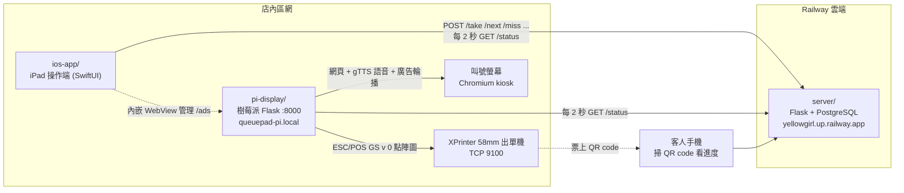

# 黃毛丫頭叫號系統 (YellowGirl Queue System)

店內號碼牌 / 叫號系統的完整原始碼，包含雲端伺服器、iPad 操作 App、樹莓派出單與叫號顯示機。

## 系統架構

**伺服器是唯一的真實狀態來源。** iPad 和樹莓派之間不直接溝通，兩邊各自每 2 秒輪詢 `/status`。

## 一張號碼牌的流程

1. **取號**：店員在 iPad 按「取號」（長按可一次取 1–20 張），App 呼叫 `POST /take`。伺服器把 `next_no` 加入 `waiting` 佇列並遞增。
2. **出單**：樹莓派輪詢時發現 `waiting` 多了新號碼，用 Pillow 合成票面（背景圖 + 大號碼 + 等候人數 + QR code），轉成 1-bit 點陣，用 ESC/POS `GS v 0` 指令經 TCP 9100 送到出單機。已印號碼記在 `printed.log`，避免重複出單。
3. **語音**：同時用 gTTS 預先產生「X 號」中文語音 mp3，叫號時直接播放。
4. **叫號**：店員按「下一號」呼叫 `POST /next`，`waiting` 第一個號碼變成 `current`。叫號螢幕顯示新號碼並播放語音。
5. **過號**：`POST /miss` 把 `current` 移到 `missed`，並自動叫下一號。過號清單可在 App 裡刪除（`DELETE /missed/<n>`）。
6. **歸零**：伺服器每天台灣時間早上 6 點自動歸零，號碼到 1000 也會歸零。也可以手動 `POST /reset`。樹莓派看到號碼從 1 重新開始時，會清掉出單紀錄。

## 資料夾

| 資料夾 | 內容 | 狀態 |
|---|---|---|
| `server/` | Flask 伺服器，狀態存在 PostgreSQL 的 key-value 表。另有抽獎轉盤功能（`/prizes`、`/draw`、`/prize-admin`）與網頁控制台 `/control` | 現役，部署在 Railway |
| `ios-app/` | iPad 操作 App（Xcode 專案名 TicketSystem）。取號、叫號、過號、標記、返回前一號、按鈕冷卻時間。另有 Live Activity 與 `next`、`miss` 深層連結的雛形，但尚未完成啟用 | 現役，最新版 |
| `pi-display/` | 樹莓派程式。出單（可關掉，改由 StudioX POS 的 iPad 直接印）、語音、叫號顯示頁、廣告影片輪播與後台 `/ads` | 現役，以 systemd `queuepad.service` 執行 |
| `legacy/ios-queuepad/` | 舊版 iPad App（QueuePad-1）。用 XYSDK 藍牙直接列印，伺服器為 Cloud Run | 已被 `ios-app/` 取代 |
| `legacy/tvos-queuepad/` | 最早的 Apple TV 叫號雛形 | 封存 |

## 伺服器 API

| 方法 | 路徑 | 作用 |
|---|---|---|
| GET | `/status` | 回傳 `current`、`waiting`、`missed`、`marked`、`next_no` |
| POST | `/take` | 取號 |
| POST | `/next` | 叫下一號 |
| POST | `/miss` | 目前號碼過號並叫下一號 |
| DELETE | `/missed/<n>` | 從過號清單移除 |
| POST | `/previous` | 目前號碼放回佇列最前面 |
| POST / DELETE | `/mark/<n>`、`/unmark/<n>` | 標記號碼 |
| POST | `/reset` | 手動歸零 |
| GET | `/healthz` | 健康檢查 |

## 部署

- **伺服器**：Railway（Nixpacks，`python main.py`），需要 `DATABASE_URL`。原專案的 git remote 是 Railway。
- **樹莓派**：`pi-display/deploy.sh` 用 scp 上傳到 `pi@queuepad-pi.local:/home/pi/queuepad-display` 再重啟 `queuepad.service`。
- **iPad**：用 Xcode 開 `ios-app/TicketSystem.xcodeproj` 建置。伺服器網址可在 App 設定頁修改。

## 樹莓派設定檔（`pi-display/static/print/`）

出單機 IP、伺服器網址、QR code 網址樣板、列印張數、列印品質都存在純文字檔，也可以從 `/ads` 後台修改。
GitHub 上的版本是 2025-09 同步的，樹莓派本機的設定可能已經更新過。

## 整合進 StudioX POS

StudioX POS（iPad 收銀台）的「叫號」頁取代 `ios-app/`，號碼牌改由 iPad 直接印：

1. **iPad 直接出單**：POS 的出單機設定裡，把這台 XPrinter（網路 TCP 9100 或藍牙）的用途勾「號碼牌」。在這台 iPad 取號就馬上印；
   如果別的地方（網頁控制台、另一台 iPad）也會取號，在這台打開「也印別台取的號碼」，它就照樣接手樹莓派原本的出單。
   票面照舊：背景圖（`bg.jpg` 上傳到 POS 後台的「叫號」頁）、號碼、等候人數、QR code 的位置預設和樹莓派一模一樣。
2. **樹莓派只負責叫號螢幕與語音**：`/ads` 後台「快速操作」把「出單」切成「不出單」（`static/print/print_enabled.txt`），
   避免印兩張。關掉期間的號碼照樣記成印過，之後再打開也不會補印。
3. **號碼存在哪裡**（POS 後台「叫號」頁設定）：
   - 沿用這台伺服器（`legacy`）：POS 後台代轉到 Railway 上的 `server/`，樹莓派的網址都不用改
   - 改用 POS 後台（`native`）：有驗證、一次一筆不會互相覆蓋。樹莓派的 `server_url.txt` 換成後台給的 `/api/pos/queue/status`、
     `qr_url.txt` 換成後台給的客人頁網址，之後就可以停掉 Railway 上的伺服器

## 已知注意事項

- 伺服器 API 沒有任何驗證，知道網址的人都能取號或歸零。
- 樹莓派後台和 SSH 密碼直接寫在程式碼裡。
- 伺服器用「讀取→修改→寫回」更新 JSON 狀態，同時大量取號可能互相覆蓋。
